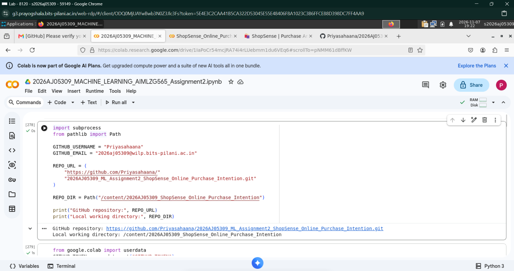
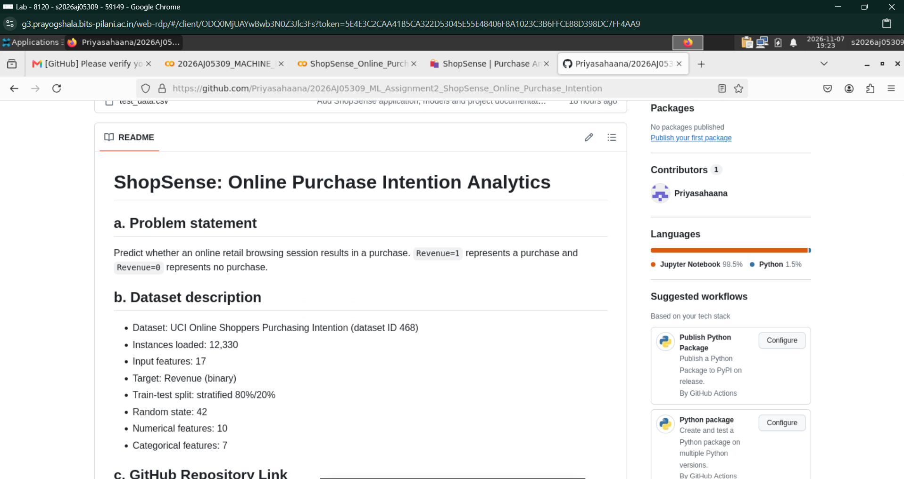
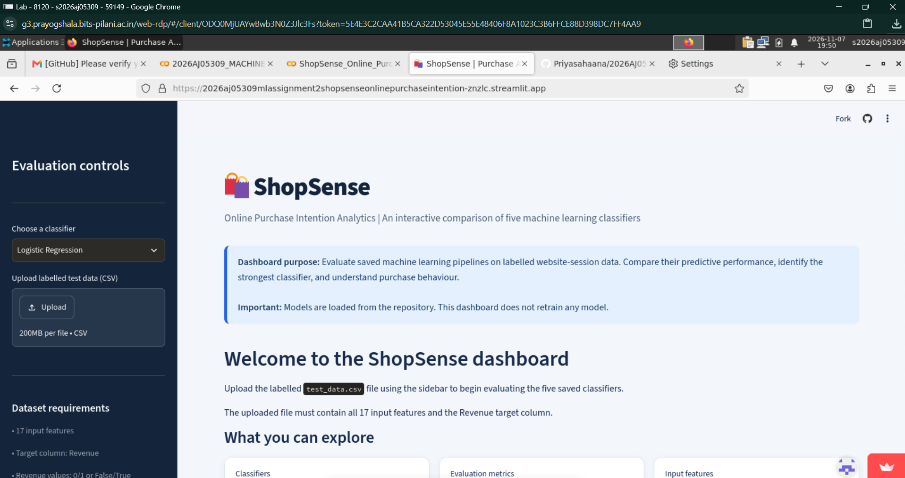

# ShopSense: Online Purchase Intention Analytics

## a. Problem statement
Predict whether an online retail browsing session results in a purchase. `Revenue=1` represents a purchase and `Revenue=0` represents no purchase.

## b. Dataset description
- Dataset: UCI Online Shoppers Purchasing Intention (dataset ID 468)
- Instances loaded: 12,330
- Input features: 17
- Target: Revenue (binary)
- Train-test split: stratified 80%/20%
- Random state: 42
- Numerical features: 10
- Categorical features: 7

## c. GitHub Repository Link
[ShopSense GitHub Repository](https://github.com/Priyasahaana/2026AJ05309_ML_Assignment2_ShopSense_Online_Purchase_Intention)

## d. Models used and evaluation

All five classifiers were trained and evaluated using the same stratified training and test partitions.

### Comparison of evaluation metrics

| ML Model Name | Accuracy | AUC | Precision | Recall | F1 | MCC |
|---|---:|---:|---:|---:|---:|---:|
| Decision Tree | 0.8873 | 0.8887 | 0.6926 | 0.4895 | 0.5736 | 0.5211 |
| Logistic Regression | 0.8808 | 0.8828 | 0.7366 | 0.3586 | 0.4824 | 0.4592 |
| Support Vector Machine | 0.8873 | 0.8824 | 0.7047 | 0.4686 | 0.5629 | 0.5149 |
| KNN | 0.8723 | 0.8285 | 0.7055 | 0.3010 | 0.4220 | 0.4049 |
| Naive Bayes | 0.2729 | 0.7334 | 0.1726 | 0.9738 | 0.2933 | 0.1289 |

### Observations on model performance

| ML Model Name | Observation about model performance |
|---|---|
| Decision Tree | The Decision Tree gave the best overall results among the five models. It achieved the highest AUC (0.8887), F1 score (0.5736) and MCC (0.5211), while sharing the highest accuracy (88.73%) with SVM. Its precision and recall were reasonably balanced, making it a good choice for this dataset. |
| Logistic Regression | Logistic Regression achieved the highest precision (0.7366), so its positive predictions were comparatively reliable. However, its recall was only 0.3586, meaning it failed to identify a considerable number of actual purchase sessions. Its overall performance was good, but it was less effective at detecting purchases. |
| Support Vector Machine | SVM performed close to the Decision Tree, with the same accuracy of 88.73% and an F1 score of 0.5629. Its precision and recall were fairly balanced, and its MCC of 0.5149 indicates good predictive performance. However, it did not outperform the Decision Tree across the overall comparison. |
| KNN | KNN achieved an accuracy of 87.23%, but its recall was relatively low at 0.3010. This suggests that it missed many actual purchase sessions despite having reasonable precision. Its lower AUC and F1 score also indicate that it was less effective than Decision Tree, Logistic Regression and SVM for this dataset. |
| Naive Bayes | Naive Bayes identified most actual purchase sessions, achieving the highest recall of 0.9738. However, its accuracy (27.29%) and precision (0.1726) were very low. This suggests that it predicted purchases too frequently, resulting in many false positives. Its overall performance was the weakest among the five models. |

### Overall winner for the dataset

**Overall winner based on average ranking across the six evaluation metrics:** Decision Tree

The final selection should also consider the confusion matrices and the relative importance of false positives and false negatives.

## Streamlit application
The application supports labelled CSV upload, model selection, all six evaluation metrics, a confusion matrix, and a classification report. It loads saved model pipelines and does not retrain on uploaded test data.

## Run locally
```bash
pip install -r requirements.txt
streamlit run app.py
```

## Repository contents
- `app.py` — Streamlit application
- `requirements.txt` — application dependencies
- `README.md` — project documentation
- `test_data.csv` — held-out labelled test data
- `model/` — five saved preprocessing and classifier pipelines
- `model_comparison.csv` — model evaluation results
- `metadata.json` — experiment metadata
- `assets/` — EDA and evaluation plots
- `2026AJ05309_MACHINE_LEARNING_AIMLZG565_Assignment2.ipynb` — complete notebook source code

## Live Streamlit application

**ShopSense interactive dashboard:**

[Open the Live ShopSense Application](https://2026aj05309mlassignment2shopsenseonlinepurchaseintention-znzlc.streamlit.app/)

The application allows users to upload labelled test data, select one of five saved classifiers, view six evaluation metrics, compare model performance, and explore ROC curves and confusion matrices. The application evaluates uploaded data without retraining the models.

## BITS Virtual Lab evidence

The following screenshots provide evidence of the assignment execution in BITS Virtual Lab.

### Screenshot 1 — BITS Virtual Lab execution



### Screenshot 2 — BITS Virtual Lab execution



### Screenshot 3 — BITS Virtual Lab execution



